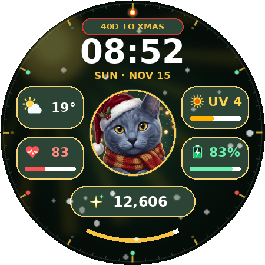
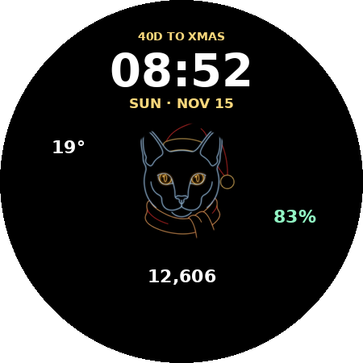
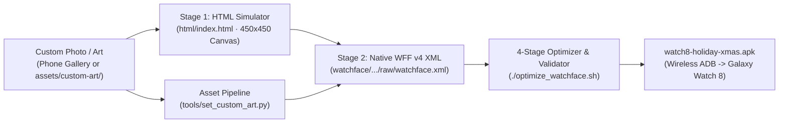

# Galaxy Watch 8 Holiday & Custom Photo Watch Face (`WFF v4`)

<p align="center">
  
  &nbsp;&nbsp;&nbsp;&nbsp;
  
</p>

<p align="center">
  <strong>Wear OS 6 (API 36)</strong> · <strong>Watch Face Format v4</strong> · <strong>Zero Kotlin/DEX (<code>android:hasCode="false"</code>)</strong> · <strong>1:1 HTML Simulator + AI Agent Ready</strong>
</p>

---

A standalone, battery-optimized holiday watch face and interactive browser simulator built specifically for the **Samsung Galaxy Watch 8** (`44mm`, `40mm`, and `46mm Classic`) on **Wear OS 6 / One UI 8 Watch**.

Users can **pick any custom photo of their own pet or family directly from the Galaxy Wearable phone app** (via native WFF v4 `<PhotosConfiguration>`), test layouts live in the zero-server `html/` simulator, or bake custom artwork into their own `.apk` in a single command.

## Highlights

- **3 Ways to Use Your Own Image:**
  1. **On Your Phone (Zero Code):** Select *Centerpiece Art → Custom Photo (Phone)* in Galaxy Wearable to place any photo from your phone gallery into the central circular medallion.
  2. **In Your Browser (`html/index.html`):** Drag/upload any local image live into the interactive Watch 8 simulator (`file://` compatible, no server required).
  3. **One-Command APK Builder (`tools/set_custom_art.py`):** Crop any image, auto-synthesize a burn-in-safe `< 4%` OPR Always-On Display outline, regenerate all WebP assets, and compile a signed `.apk`.
- **Live Weather Sky & Reactive Particles:** Automatic sky ambience (sunbeams, clouds, starry night, rain canopy) and `<= 15 FPS` snow/rain/wind loops driven natively by `[WEATHER.CONDITION]` + wrist-tilt gyro parallax.
- **5 Universal Complication Capsules (Zero Bezel Clipping):**
  - **Slot 1 (Upper-Left):** Weather temperature + condition icon (with native `[WEATHER.*]` fallback)
  - **Slot 2 (Upper-Right):** Sun Heat / UV Index `0–11` + progress bar
  - **Slot 3 (Lower-Left):** Heart Rate BPM + pulse gauge
  - **Slot 4 (Lower-Right):** Live Watch Battery `%` + low-battery coral alert (`<= 25%`)
  - **Slot 5 (Bottom):** Energy Score / Steps / Custom provider + unclipped curved progress arc
  - *Supports custom phone/watch complications (`SHORT_TEXT`, `RANGED_VALUE`, `GOAL_PROGRESS`, `MONOCHROMATIC_IMAGE`, `SMALL_IMAGE`, `LONG_TEXT`).*
- **Smart Battery Saver & Burn-In-Safe AOD:**
  - **Auto Eco Mode (Default):** Smooth 4-second wake burst, then `0 FPS` idle particles + automatic animation cutoff at `<= 25%` battery.
  - **Ambient (AOD) OPR `3.95%`** (well under Samsung's `15%` burn-in limit; `92.9%` pure black off-pixels).
  - **Tiny Memory Footprint:** `~9 MB / 100 MB` Active RAM · `~6.1 MB / 10 MB` Ambient RAM · `~315 KB` APK.
- **Lock-Screen Visibility Option:** Built-in *Show Info When Locked* (`Mostrar info bloqueado`) toggle to either keep live Battery `%` & gauges visible while locked or hide numbers for privacy.
- **English & Spanish Localization:** Full `values/strings.xml` + `values-es/strings.xml` out of the box.

---

## Architecture



## Repository Structure

```text
├── .github/workflows/
│   ├── ci.yml                       # Automated tests, WFF v4 XSD/RAM audit & Release APK
│   └── pages.yml                    # Auto-deploys interactive simulator + APK to GitHub Pages
├── .githooks/
│   └── pre-commit                   # Auto-version bump, APK rebuild & test gate on commit
├── AGENTS.md                        # AI coding agent architecture rules & constraints
├── .agents/
│   ├── agents/watchface-customizer.md
│   └── skills/
│       ├── wff-custom-assets/       # Artwork generator & asset prep scripts
│       ├── wff-watch8-simulator/    # 1:1 Watch 8 HTML/CSS/JS simulator skill
│       └── wff-apk-builder/         # Native WFF v4 XML, validator & ADB skill
├── assets/custom-art/               # Git-ignored drop-in folder for your own photos
├── docs/
│   ├── CUSTOMIZATION.md             # Step-by-step image, theme & XML customization guide
│   └── images/                      # Generated Active & AOD watch face previews
├── html/                            # Zero-server interactive Galaxy Watch 8 simulator
├── tests/
│   └── test_watchface.py            # Fast parity, localization & burn-in regression suite
├── tools/
│   ├── bump_version.py              # Lockstep version bumper across Gradle, HTML & optimizer
│   ├── install_hooks.sh             # One-command activator for .githooks/pre-commit
│   ├── set_custom_art.py            # One-command custom image + AOD outline importer
│   └── optimize_watchface.py        # 4-stage WebP, geometry, OPR, XSD & RAM optimizer
├── watchface/                       # Standalone Wear OS 6 (API 36) WFF v4 Gradle project
│   └── install_to_watch8.sh         # Interactive / auto-mDNS Wireless ADB installer
├── optimize_watchface.sh            # Convenience wrapper for the 4-stage build pipeline
└── watch8-holiday-xmas.apk          # Prebuilt, validated WFF v4 package ready to sideload
```

---

## Quick Start

### 1. Preview Live in Your Browser (Zero Dependencies)

Open [`html/index.html`](html/index.html) directly in Chrome, Firefox, Edge, or Brave:

```bash
xdg-open html/index.html   # Linux
# or: open html/index.html (macOS) / start html\index.html (Windows)
```

- Switch between **Watch 8 44mm**, **40mm**, and **46mm Classic**.
- Toggle **Active** vs. **Always-On (AOD)**, **Digital / Analog / Hybrid**, **Color Themes**, and **Simulate Watch Locked**.
- Click **📸 Upload Any Pet / Holiday Photo Live in Medallion** to test your own photo immediately.

### 2. Sideload to Your Samsung Galaxy Watch 8 Over Wi-Fi

Enable **Developer options → ADB debugging → Wireless debugging** on your Watch 8 (connected to the same Wi-Fi as your computer), then run:

```bash
./watchface/install_to_watch8.sh
```

*(Or directly via `adb`: `adb install -r watch8-holiday-xmas.apk`)*

> **Tip (Locked Watch Complication Privacy on One UI Watch):** By default, Samsung's OS hides third-party/health complication providers while PIN-locked. In addition to this watch face's **Show Info When Locked** option, you can allow full complication data while locked on your watch under **Settings → Security and privacy → Lock type → Hide information → Off**.

### 3. Replace the Default Artwork & Rebuild the APK

Prerequisites for building from source:
- **Python 3.10+** with [`uv`](https://docs.astral.sh/uv/) (or `pip install pillow`)
- **JDK 17+** (`JAVA_HOME`)
- **Android SDK** (`compileSdk 36`, `build-tools`, `platform-tools` in `ANDROID_HOME` or `~/Android/Sdk`)

Swap in your own photo and run the full 4-stage optimizer + validator + Gradle build:

```bash
uv run --with pillow python3 tools/set_custom_art.py \
    --input assets/custom-art/my_pet.jpg \
    --build
```

Or run the 4-stage optimizer and validator anytime after editing `watchface.xml`:

```bash
./optimize_watchface.sh
```

See [`docs/CUSTOMIZATION.md`](docs/CUSTOMIZATION.md) for full details on themes, localization, complications, and package IDs.

---

## Automated Testing, CI & GitHub Pages

### Run the Test Suite Locally (`< 0.5s`)

```bash
uv run --with pillow python3 -m unittest discover -s tests -v
```

`tests/test_watchface.py` checks JS syntax, broken HTML/JS asset paths, 1:1 complication slot coordinate parity (`html/` vs `watchface.xml`), flat `<Scene>` configuration safety (preventing Samsung `EditorActivity` crashes), `<= 15 FPS` / zero-`TAP` sprite rules, English/Spanish `strings.xml` parity, and `< 10%` OPR custom AOD synthesis.

### Git Pre-Commit Hook & Automatic Version Bumping (`.githooks/pre-commit`)

Enable the repository's tracked Git hooks once after cloning:

```bash
./tools/install_hooks.sh
```

On every `git commit`, `.githooks/pre-commit` automatically:
1. Increments `versionCode` (`+1`) and `versionName` (`patch` by default) in lockstep across `watchface/app/build.gradle.kts`, `html/index.html`, and `tools/optimize_watchface.py` via `./tools/bump_version.py`.
2. Rebuilds & validates `watch8-holiday-xmas.apk` + `watchface/optimization_report.json` when a local Android SDK/JDK is installed.
3. Runs `./tools/bump_version.py --check` and the `tests/test_watchface.py` suite before allowing the commit.

```bash
git commit -m "Update theme colors"                  # Auto patch bump (e.g. 2.3.0 -> 2.3.1)
BUMP=minor git commit -m "Add new complication"      # Auto minor bump (e.g. 2.3.1 -> 2.4.0)
SKIP_VERSION_BUMP=1 git commit -m "Docs typo fix"    # Keep version unchanged, still run tests
```

### GitHub Actions CI & Releases (`.github/workflows/ci.yml`)

- Runs automatically on every push and pull request to `main`: executes the test suite, validates WFF v4 XSDs (`wff-validator.jar`), compiles the signed APK (`0` `.dex` files), enforces `< 10 MB` Ambient / `< 100 MB` Active RAM (`memory-footprint.jar`), and uploads `watch8-holiday-xmas.apk` as a build artifact.
- Pushing any version tag (`git tag v2.3.0 && git push --tags`) automatically creates a **GitHub Release** with `watch8-holiday-xmas.apk` attached.

### Live Interactive Demo on GitHub Pages (`.github/workflows/pages.yml`)

1. In your GitHub repo, open **Settings → Pages**.
2. Under **Build and deployment → Source**, select **GitHub Actions**.
3. Every push automatically deploys `html/` + `watch8-holiday-xmas.apk` to **`https://deiividramirez.github.io/galaxy-watch8-xmas-wff/`**, complete with the live Watch 8 simulator, client-side custom photo uploader, and a **⬇️ Download Watch 8 APK** button.

---

## Using With AI Coding Agents

This repository is structured out of the box for agentic coding tools (**Google Antigravity**, **Claude Code**, **Cursor**, **Codex**, **GitHub Copilot**):

- Project rules and hardware guardrails live in [`AGENTS.md`](AGENTS.md).
- Reusable skills and helper scripts live in [`.agents/skills/`](.agents/skills/) and [`.agents/agents/`](.agents/agents/).
- Example prompt you can give your agent after cloning:
  > *"Use `assets/custom-art/my_dog.png` as the primary centerpiece, add a 'Midnight Gold & Velvet' color theme in both the HTML simulator and `watchface.xml`, and run `./optimize_watchface.sh` to verify all WFF v4 limits."*

---

## License

Released under the [MIT License](LICENSE).
